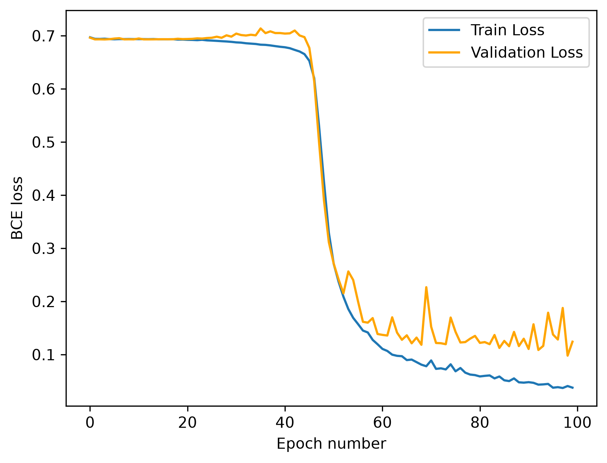
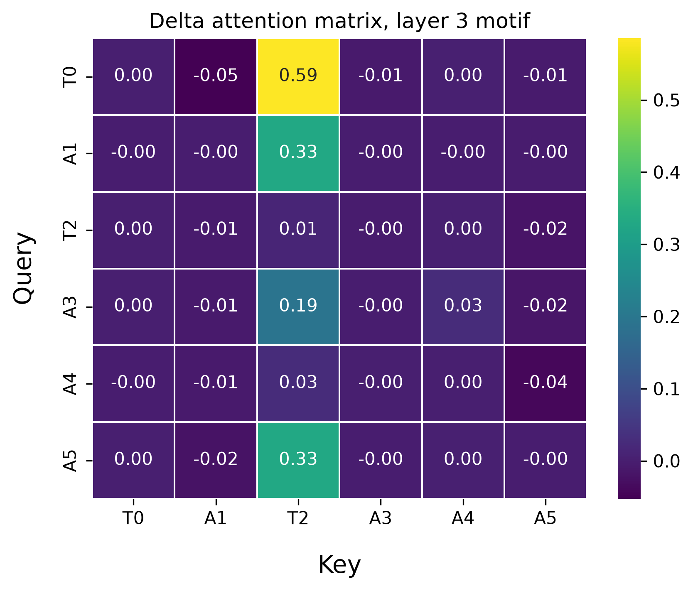
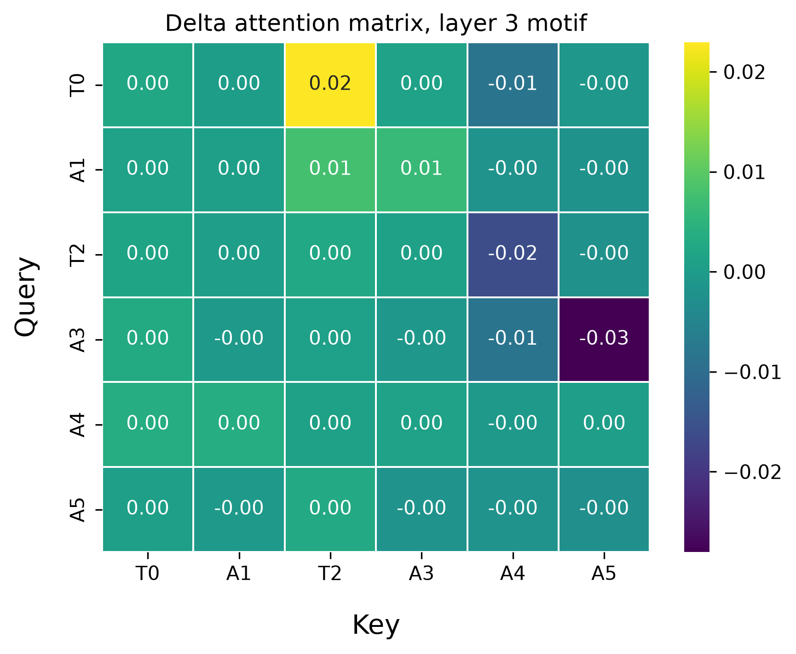

# Transformer from Scratch for Biological Sequences
This project implements the core components of a transformer from scratch in PyTorch with the goal of training a transformer block for biological seqeunce classification.

Rather than use nn.Transformer or pretrained models I am building it from first principles. I am using scaled dot-product attention, multi-head attention, positional encoding, Transformer encoder blocks, and the training pipeline directly to develop deeper understanding of transformer architecture and scientific deep learning. 

# Current Roadmap:

- Scaled dot-product attention - Completed
- Single-head self-attention - Completed
- Multi-head attention - Completed
- Positional encoding - Completed
- Transformer encoder block - Completed
- Biological sequence dataset - Completed
- Sequence classification - Completed
- Baseline comparison - Completed
- Model interpretation - Completed

# Data
I generated synthetic 100 bp long DNA sequences containing either the positive motif 'TATAAA' or the negative control 'AAATAT' in it's place. I then trained a transformer to be able to distinguish between the two motif classes. Because the motifs have identical nucleotide composition but differ in nucleotide order, the model must use positional information rather than base composition alone to solve the classification task.

# Results

I first implemented positional information through absolute sinusoidal encoding. The transformer struggled to learn the motif, failing to generalize to the validation set (50% accuracy, equivalent to random classification). Absolute positional encoding likely made this task more difficult because the model had to learn that the same TATAAA motif was predictive regardless of its absolute position in the sequence. In other words, the model needed to learn both the nucleotide ordering that defined the motif and to recognize that pattern across different positions.

I used a CNN as a baseline, which quickly learned the motif with high accuracy (99.5%). CNNs are particularly well suited for detecting localized motifs because convolutional filters apply the same learned pattern across sequence positions. I used a kernel size of 6, matching the length of the six-nucleotide motif. Inspection of the trained convolutional filters showed that one filter had learned to specifically recognize the TATAAA sequence.

Because the Transformer with absolute positional encoding failed to generalize, I next implemented a learned relative-position bias based on the distance between sequence positions. Unlike absolute positional encoding, this allows the same relative positional relationships to be shared across different locations in the sequence. This architecture successfully solved the classification task, achieving 99.9% validation accuracy.

 Below is a table of the performences of the different model architectures.

| Model | Positional information | Validation accuracy | Result |
|---|---|---:|---|
| CNN | Translation-equivariant convolution | **~99.5%** | Successfully learned the randomly positioned motif |
| Transformer | None | **~50%** | Remained at chance performance |
| Transformer | Absolute sinusoidal encoding | **~50%** | Remained at chance performance |
| Transformer | Learned relative-position bias | **~99.9%** | Successfully learned the randomly positioned motif |
---

The model trained for approximately 40 epochs before the training and validation losses began to decrease substantially. The training and validation loss curves begin to diverge around epoch 55, suggesting that early stopping could help limit overfitting.

---
After achieving high accuracy with the relative-position Transformer, I examined the learned attention patterns to better understand how the model distinguished between the two motifs. Comparing the attention assigned between query and key positions revealed several motif-dependent patterns. The strongest pattern emerged in the first attention head of the third Transformer layer.

In several independently trained models, the first T position (T0) showed increased attention toward the second T position (T2) in TATAAA compared with the matched AAATAT controls. The example below shows the mean difference in attention between positive and matched negative sequences, where the strongest increase occurs from the T0 query to the T2 key.

---

---

In plots above the transformer model was trained using 10000 positive and negative motifs (TATAAA vs AAATAT). Then the model was tested on 100 position matched positive and negative motifs and the resuliting attention of the 6 toke motif on itself was extracted for all 100 matched sequenced. The delta attention matrix was generated by subtracting the positive and negative attention matrixes and taking the average. For this particular layer we see the first T pays strong attention to the second T in the positive motif relative to the negative control. This pattern emmerged across several different model initiations suggesting it is a strong way for the models to differentiate the motifs. 